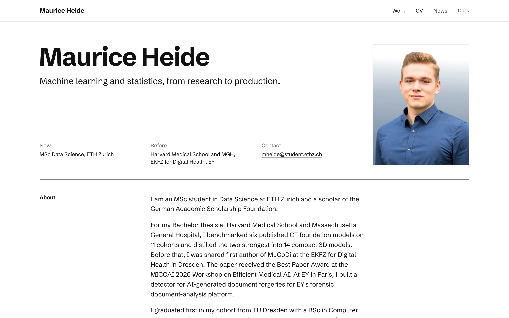
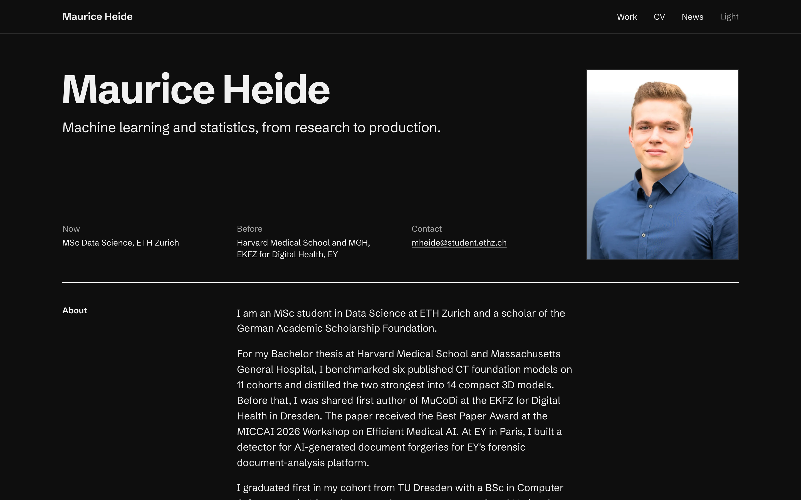

# mooofna.github.io

The personal homepage of Maurice Heide, live at **https://mooofna.github.io**.



A plain, strict layout: a 12-column grid with a label column and a content column, one grotesque typeface (Schibsted Grotesk) with IBM Plex Mono for dates and figures, hairline rules and one accent colour (ETH blue). The theme follows the system setting, and a toggle in the header switches between light and dark.

| Dark theme                                             | Phone                                             |
| ------------------------------------------------------ | ------------------------------------------------- |
|  |  |

## How the Singapore demo connects

GitHub Pages serves every repository with Pages switched on below this site, so the [Singapore Urban Heat](https://github.com/mooofna/singapore-urban-heat) explorer lives at [/singapore-urban-heat/](https://mooofna.github.io/singapore-urban-heat/). Its project card reads `data/manifest.json` and `data/summary.json` from the demo at page load and shows the current number of clear Landsat scenes, the date range and the release version. The demo updates itself every month, so the card does too, without a rebuild here. If the files are missing or their schema changes, the card keeps its static text and shows no numbers ([src/scripts/live.ts](src/scripts/live.ts)).

## Editing

| What                                                 | Where                                                                  |
| ---------------------------------------------------- | ---------------------------------------------------------------------- |
| Projects (card text, links, image, long description) | `src/content/projects/*.md`                                            |
| News                                                 | `src/data/news.yaml`                                                   |
| Publications                                         | `src/data/publications.yaml`                                           |
| Web CV                                               | `src/data/cv.yaml`                                                     |
| Name, email, profile links                           | `src/data/site.ts`                                                     |
| About text and contact                               | `src/pages/index.astro`                                                |
| Colours, type scale, grid, spacing                   | `src/styles/theme.css`, `src/styles/global.css`                        |
| Portrait                                             | `src/assets/portrait.jpg` (re-encoded at build time, metadata removed) |
| CV PDF                                               | `cv/Maurice_Heide_CV.tex`, then `npm run cv`                           |

Every colour in `theme.css` is written as `light-dark(light, dark)`, so one line changes both themes. The footer shows the build date and the commit the site was built from.

## Development

```bash
npm ci
npm run dev          # http://localhost:4321
npm run check        # astro check
npm run lint         # prettier
npm run e2e          # Playwright: every page in both themes, axe, theme toggle, live card, 404
python3 scripts/check_style.py   # house style: no em dashes, en dashes or middle dots
```

`npm run cv` needs a TeX installation with `latexmk` and `xelatex`; the Libertine and Biolinum fonts ship with TeX Live. `npm run icons` redraws the tab icon ("MH" in the site's typeface) and its PNG and ICO versions. `node scripts/screenshots.ts demo` refreshes the Singapore card image from the live demo, and `node scripts/screenshots.ts site` renders the README screenshots and the Open Graph image from a running `npm run preview`.

Pushes to `main` deploy through GitHub Actions ([deploy.yml](.github/workflows/deploy.yml)). CI runs the type check, formatting, the house style check over sources and built pages, an internal link check and the Playwright suite.

The site sets no cookies, loads no third-party scripts or fonts and has no analytics.

## License

The code is MIT licensed ([LICENSE](LICENSE)). The text, the CV, the portrait and the project images are not: all rights reserved. The MuCoDi figure is Fig. 1 of [arXiv:2607.05533](https://arxiv.org/abs/2607.05533); the Singapore screenshot contains map data from OpenStreetMap contributors via OpenFreeMap and OpenMapTiles.
